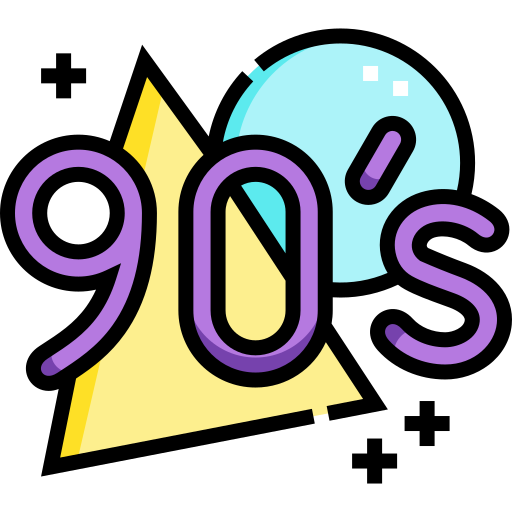

Connecting the Why, the What, and the How since the 
-------------------------------------------------------

I'm Jeremy, a digital transformation leader based in Arlington, Virginia. I've worked in technology since the late '90s, and I enjoy building collaborative teams that modernize products and architectures and help organizations reach their strategic goals.

  
  

## Highlights
- **25+ years** in software, architecture and technology leadership
- **5x** growth of a global, cross-functional engineering team in one year
- **$20M** Series A funding secured as CTO of a health technology company
- **50%+** of company revenue from a DevSecOps platform I led engineering for
- Converted an enterprise .NET monolith into an Azure microservices SaaS platform

## Current Projects
- **The Villager App:** A mobile-first app to support positive youth development, using AI in development, testing and in the app itself.
- **Continuous learning:** Working on the IBM AI Professional Certificate and renewing my PMP.

## Professional Focus
- **Architecture:** Modern software design with .NET 10, Azure and containers (Docker/Kubernetes).
- **Leadership:** Engineering management focused on delivery and scaling teams.
- **Transformation:** Moving legacy systems to cloud-native, AI-enabled platforms with modern DevSecOps.

## Skills

  <strong>Strategy &amp; Leadership</strong> 
  
  
  
  
  
  
  
  
  

   <strong>Program &amp; Operations</strong> 
  
  
  
  
  
  
  
  

   <strong>Cloud &amp; Infrastructure</strong> 
  
  
  
  
  

   <strong>Software Engineering</strong> 
  
  
  
  
  
  
  
  
  
  
  

   <strong>Methods &amp; Quality</strong> 
  
  
  
  
  

## Certifications &amp; Education
- SAFe Agilist · Microsoft Certified: Azure Developer Associate · Develop Generative AI Applications · Product Strategy
- Product Strategy Certificate (Product-Led Growth), Northwestern Kellogg
- M.S., Management of Information Technology, University of Virginia McIntire
- B.S., Computer Science, Rensselaer Polytechnic Institute

## Interests
- **Travel:** My wife and I are working on all seven continents, with more eco-tourism lately, including the Galápagos, Peru and Bolivia. Africa is next.
- **Outdoors:** Hiking, swimming and anything outside.
- **Music:** I play guitar and bass in a classic rock band. In music school I helped start a punk/ska band that's still playing today.
- **Sports:** Baseball (Red Sox) and American football (Patriots). I'm from New England originally, and I'm working my way through every Major League ballpark.
